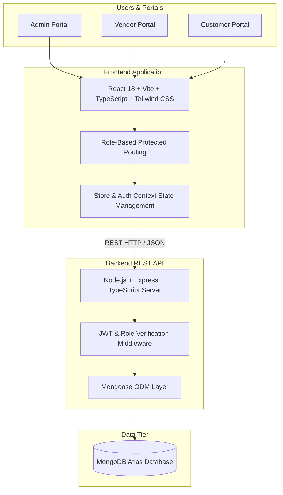

# Smart Inventory

**Smart Inventory** is an enterprise-grade full-stack inventory, point-of-sale (POS), and multi-vendor e-commerce management platform built specifically for mobile phone and electronics retail businesses.

---

## System Architecture



---

## Key Features

### 👑 Admin Portal
- **Executive Dashboard**: Real-time high-level KPIs, inventory valuation, stock warnings, sales volume, and quick navigation.
- **Product Management**: Full CRUD operations across multi-tier product hierarchies (Smartphones, Keypad phones, Secondhand devices, and 7+ Accessory categories).
- **Intelligent Autocomplete**: Model suggestion engine for fast catalog entry.
- **Inventory Control**: Live stock tracking, low-stock threshold triggers, and audit logging for stock adjustments (`IN`, `OUT`, `DAMAGE`, `ADJUSTMENT`, `RETURN`).
- **Point of Sale (POS) / Sales Management**: Direct counter billing, atomic stock deduction, receipt generation, and transaction history.
- **Vendor Management**: Provisioning vendor accounts, setting business profiles, status toggles (Active / Suspended).
- **Customer & Order Management**: Full customer directory, order fulfillment lifecycle management (Pending, Processing, Shipped, Delivered, Cancelled).
- **Reports & Analytics**: Visual revenue analytics, category sales distributions, and stock holding breakdowns.

### 🏢 Vendor Portal
- **Vendor Dashboard**: Supplier-specific metrics, holding valuations, active purchase orders, and revenue stats.
- **Supplied Products Catalog**: Dedicated inventory catalog filtered strictly to the authenticated vendor.
- **Purchase Order (PO) Fulfillment**: Receive, accept, dispatch, and track warehouse replenishment requests.
- **Counter Sales**: Record direct retail sales with automatic stock deduction and supplier attribution.
- **Payments & Financial Settlements**: Net-15 settlement tracking, bank account verification, and disbursement records.
- **Vendor Reports**: Historical sales breakdowns, stock movements, and financial statements.

### 🛍️ Customer Portal
- **Storefront & Catalog**: Category-filtered browsing, live search, and dynamic stock badges.
- **Cart & Checkout**: Real-time pricing, promotional discount codes (`SMART20`, `FIRST10`), address management, and instant order placement.
- **Order History & Tracking**: Order timeline inspection with tracking reference IDs.
- **Customer Profile**: Personal account information and address management.

---

## Product Hierarchy Architecture

```
Mobiles
├── Smartphones (Apple, Samsung, Google, OnePlus, Xiaomi, Vivo, iQOO, Realme, Motorola, etc.)
├── Secondhand Mobiles (Graded & Refurbished devices)
└── Keypad Phones (Lava, Reliance Jio, Samsung Guru, Micromax, Karbonn, Itel, Celkon)

Accessories
├── Cases & Protection (Back covers, Tempered glass, Camera lens protectors)
├── Chargers & Cables (GaN Fast adapters, Type-C cables, Lightning, Wireless pads)
├── Audio (TWS Earbuds, Neckbands, Wired earphones, Bluetooth speakers)
├── Holders & Mounts (Desktop metal stands, Car air-vent holders, Ring holders)
├── Storage & Connectors (MicroSD cards, OTG adapters, Card readers)
├── Photography & Content Creation (Tripods, Ring lights, Clip-on lenses)
└── Cleaning, Spares & Repair (Screen cleaning kits, Dust plugs, Toolkit sets)
```

---

## Technology Stack

### Frontend
- **Framework**: React 18
- **Build Tool**: Vite
- **Language**: TypeScript
- **Styling**: Tailwind CSS
- **Routing**: React Router v6
- **HTTP Client**: Axios
- **Icons**: Lucide React

### Backend
- **Runtime**: Node.js
- **Framework**: Express.js
- **Language**: TypeScript
- **Database ODM**: Mongoose
- **Authentication**: JSON Web Tokens (JWT) & bcryptjs
- **Configuration**: dotenv & cors

### Database
- **Primary Database**: MongoDB / MongoDB Atlas

---

## Project Structure

```
smart-inventory/
├── backend/
│   ├── src/
│   │   ├── config/
│   │   │   ├── database.ts                 # MongoDB connection logic
│   │   │   ├── jwt.ts                      # Secure JWT configuration helper
│   │   │   └── seed.ts                     # Development sample seed data
│   │   ├── controllers/
│   │   │   └── productSuggestionController.ts # Autocomplete controller
│   │   ├── middleware/
│   │   │   └── auth.ts                     # JWT & Role authorization middleware
│   │   ├── models/
│   │   │   ├── InventoryLog.ts             # Inventory transaction audit model
│   │   │   ├── Order.ts                    # Customer order model
│   │   │   ├── Product.ts                  # Product catalog model
│   │   │   ├── Sale.ts                     # Point-of-sale record model
│   │   │   ├── User.ts                     # User & role credential model
│   │   │   └── VendorRequest.ts            # Purchase order & settlement model
│   │   ├── routes/
│   │   │   ├── auth.routes.ts              # Login & customer registration
│   │   │   ├── inventory.routes.ts         # Stock adjustments & logs
│   │   │   ├── order.routes.ts             # Order lifecycle management
│   │   │   ├── product.routes.ts           # Product CRUD & catalog queries
│   │   │   ├── report.routes.ts            # Analytics & performance metrics
│   │   │   ├── sale.routes.ts              # POS transactions
│   │   │   └── vendor.routes.ts            # Vendor management & POs
│   │   ├── services/
│   │   │   └── smartphoneSuggestionService.ts # Catalog search & ranking
│   │   └── server.ts                       # Express server initialization
│   ├── .env.example                        # Backend environment template
│   ├── package.json
│   └── tsconfig.json
├── frontend/
│   ├── src/
│   │   ├── assets/                         # SVG icons & branding
│   │   ├── components/
│   │   │   ├── ui/                         # Reusable KpiCard, SearchBar, StatusBadge
│   │   │   ├── AdminLayout.tsx             # Admin sidebar & header layout
│   │   │   ├── CustomerLayout.tsx          # Storefront navigation layout
│   │   │   ├── SmartphoneAutocompleteInput.tsx # Autocomplete search component
│   │   │   └── VendorLayout.tsx            # Vendor portal sidebar layout
│   │   ├── context/
│   │   │   ├── AuthContext.tsx             # Authentication state provider
│   │   │   └── StoreContext.tsx            # Full store state provider
│   │   ├── data/                           # Catalogs, mock data & taxonomies
│   │   ├── pages/
│   │   │   ├── admin/                      # Admin views (Products, Sales, Inventory, etc.)
│   │   │   ├── customer/                   # Customer views (Cart, Orders, Profile, etc.)
│   │   │   ├── vendor/                     # Vendor views (POs, Sales, Inventory, etc.)
│   │   │   ├── AdminDashboard.tsx
│   │   │   ├── CustomerHome.tsx
│   │   │   ├── LoginPage.tsx
│   │   │   ├── VendorDashboard.tsx
│   │   │   └── WalkthroughPage.tsx
│   │   ├── routes/
│   │   │   └── ProtectedRoute.tsx          # Role-based route guard
│   │   ├── services/
│   │   │   ├── api.ts                      # Axios base instance
│   │   │   └── mockAuth.ts                 # Auth session & credential helpers
│   │   ├── utils/
│   │   │   └── vendorUtils.ts              # Dynamic vendor tenant matching
│   │   ├── App.tsx                         # App routing configuration
│   │   ├── index.css                       # Global styles & Tailwind directives
│   │   └── main.tsx                        # React DOM root entry
│   ├── .env.example                        # Frontend environment template
│   ├── index.html
│   ├── package.json
│   ├── tailwind.config.js
│   ├── tsconfig.json
│   └── vite.config.ts
├── .gitignore
├── package.json
└── README.md
```

---

## Getting Started

### Prerequisites
- [Node.js](https://nodejs.org/) (version 18 or higher)
- [npm](https://www.npmjs.com/) (version 9 or higher)
- A [MongoDB Atlas](https://www.mongodb.com/atlas) account (or a local MongoDB instance)

### Installation

1. **Clone the Repository**
   ```bash
   git clone https://github.com/Yasin-1535/Smart-Inventory.git
   cd Smart-Inventory
   ```

2. **Install Root Dependencies**
   ```bash
   npm install
   ```

3. **Install Backend Dependencies**
   ```bash
   cd backend
   npm install
   ```

4. **Install Frontend Dependencies**
   ```bash
   cd ../frontend
   npm install
   cd ..
   ```

---

## Environment Variables

### Backend Configuration (`backend/.env`)
Create a `backend/.env` file from `backend/.env.example`:

```env
PORT=5000
CORS_ORIGIN=http://localhost:5173
JWT_SECRET=your_locally_generated_secure_jwt_secret
MONGODB_URI=your_mongodb_atlas_connection_string

# External Smartphone Suggestion Provider Configuration (Optional)
SMARTPHONE_SUGGESTION_API_KEY=your_smartphone_catalog_api_key_here
SMARTPHONE_SUGGESTION_PROVIDER=catalog_provider
```

### Frontend Configuration (`frontend/.env`)
Create a `frontend/.env` file from `frontend/.env.example`:

```env
VITE_API_URL=http://localhost:5000/api
```

> **Note**: Never commit `.env` files into version control. Only commit `.env.example` templates.

---

## Running the Application

### Running Concurrently (Root)
```bash
npm run dev
```

### Running Services Independently

**Terminal 1 — Backend API**:
```bash
cd backend
npm run dev
# API Server active at: http://localhost:5000/api
```

**Terminal 2 — Frontend Application**:
```bash
cd frontend
npm run dev
# Web App active at: http://localhost:5173
```

---

## Development / Demo Accounts

The application includes predefined accounts for local development and demonstration purposes:

| Role | Demo Email | Demo Password | Purpose |
| :--- | :--- | :--- | :--- |
| **Admin** | `admin@smartinventory.com` | `Admin@123` | Full administrative control & reporting |
| **Vendor** | `vendor@smartinventory.com` | `Vendor@123` | ABC Electronics supplier workspace |
| **Customer** | `customer@smartinventory.com` | `Customer@123` | Storefront browsing & checkout |

> ⚠️ **NOTICE**: These credentials are intended for local development and demonstration only. In a production deployment, use unique, strong credentials stored securely via environment variables and hashed in MongoDB.

---

## Security Best Practices

- **Never Commit Secrets**: Ensure `.env` and `.env.*` remain in `.gitignore`.
- **Environment Isolation**: Always use `process.env` references for database URLs, JWT keys, and API keys.
- **JWT Key Management**: Generate strong random secrets for `JWT_SECRET` in production environments.
- **Strict Role-Based Access Control**: Admins create vendors; customers register publicly; vendors can only access their scoped data.
- **Credential Rotation**: In the event of an accidental credential leak, immediately revoke and rotate credentials on MongoDB Atlas and respective service providers.

---

## Current Status & Roadmap

### ✅ Completed & Implemented
- [x] Multi-Role Authentication & Access Control (Admin, Vendor, Customer)
- [x] Admin Portal with Product, Inventory, POS, Vendor, and Order Management
- [x] Vendor Portal with Purchase Order Processing, Scoped Inventory, and Settlements
- [x] Customer Storefront with Category Filtering, Cart, Promo Codes, and Order History
- [x] Multi-Tier Mobile & Accessory Taxonomy
- [x] Smartphone Model Suggestion & Autocomplete Engine
- [x] Immutable Audit Logging for Inventory Transactions
- [x] Multi-Tenant Vendor Data Isolation
- [x] MongoDB Atlas Database Connection & Sample Seeder

### 🚀 Planned / Future Roadmap
- [ ] Integration with Production Payment Gateways (Razorpay / Stripe)
- [ ] Cloud Storage for Product Images (AWS S3 / Cloudinary)
- [ ] Automated Email / SMS Notifications for Order & PO Status Updates
- [ ] Barcode & QR Code Scanner Integration for POS and Inventory Receiving
- [ ] Containerization with Docker & Docker Compose
- [ ] CI/CD Deployment Pipelines
